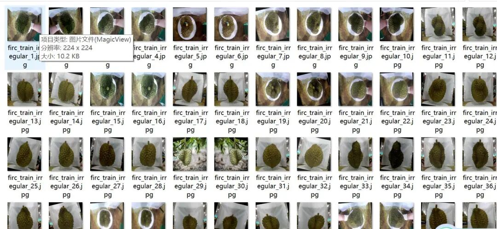
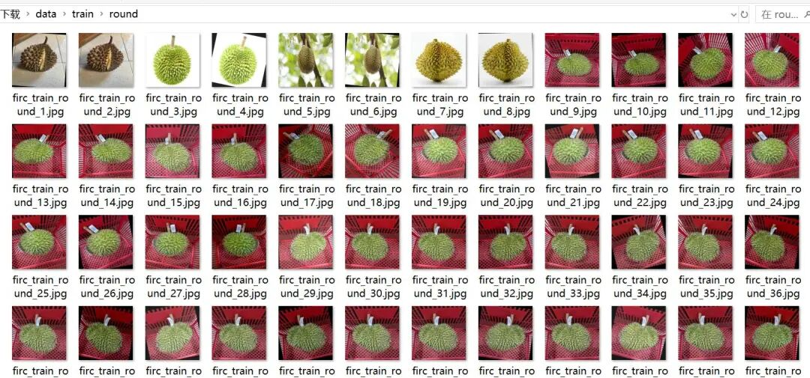
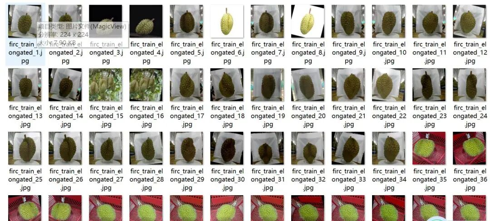

# Smart Orchard Durian Size and Shape Classification Dataset: 3314 Images in 4 Categories

Note: Approximately half of the dataset contains rotated augmented images.

Dataset type: Image classification, not for object detection without annotations.

Dataset format: Only contains jpg images, each category folder contains the corresponding image.

Number of images (number of jpg files): 3314

Category: 4

Image resolution: 224x224

Category Name: ['Unlabeled', 'elongated', 'irregular', 'round']

Number of images per category:

Number of training set images: 2728

- elongated (slender) training set image count: 828

- Irregular (Irregular) training set image count: 422

- Round training set image count: 544

- Unlabeled (unlabeled) training set image count: 934

Number of validation set images: 391

- elongated (slender) validation set image count: 122

- Irregular (Irregular) validation set image count: 53

- round (rounded) validation set image count: 82

- Unlabeled (unlabeled) validation set image count: 134

Number of test set images: 195

- elongated (slender) test set image count: 61

- irregular (irregular shape) test set image count: 35

- round (circle) test set image count: 41

- Unlabeled (unlabeled) test set image count: 58

Total number of images:

- elongated (slender) total picture count: 1011

- irregular (irregular shape) total image count: 510

- round (rounded) total image count: 667

- Unlabeled (unlabeled) Total number of images: 1126

Important Notice: No

Special : This dataset does not guarantee the accuracy of the trained models or weight files.

## Payment

Here is a pay link on Stripe ( https://buy.stripe.com/3cs8yP7sY87d0vu9AB ). Please contact me lonlonago@foxmail.com after funding $89, and I will send you a complete data files , thank you!

